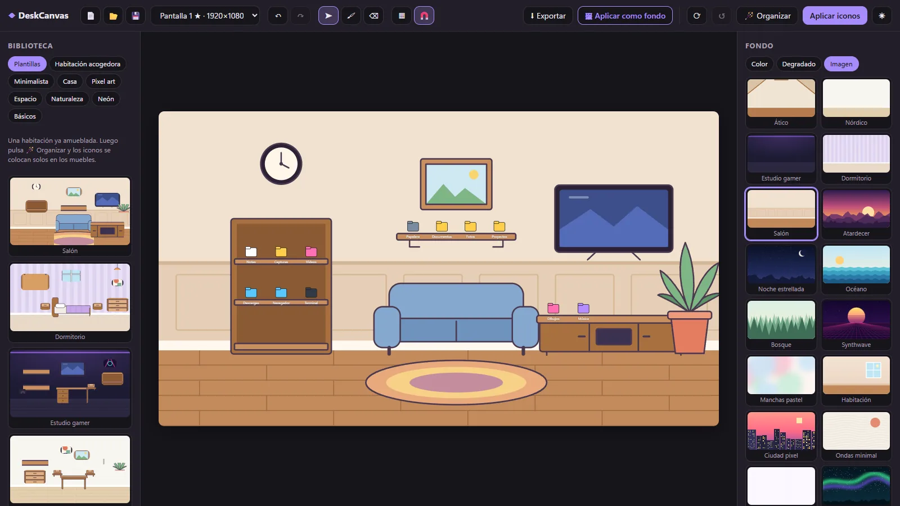

# DeskCanvas

Editor para diseñar tu fondo de pantalla viendo los **iconos reales del escritorio** dentro del lienzo. Puedes moverlos ahí mismo, aplicar la nueva disposición a Windows y exportar el fondo, sin los iconos, a la resolución exacta del monitor.

Funciona en Windows 10 y 11, con varios monitores y con escalado DPI.



## Descargar

Baja `DeskCanvas_x.y.z_x64-setup.exe` de la [última versión](https://github.com/Emb003es/DeskCanvas/releases/latest) y ábrelo. Se instala para tu usuario, sin permisos de administrador. No va firmado, así que Windows SmartScreen puede avisar la primera vez.

## Qué hace

- **Iconos reales**: lee el nombre, la imagen y la posición de cada icono del escritorio. Los arrastras en el lienzo y con **Aplicar iconos** se colocan igual en el escritorio. **Restaurar iconos** los devuelve a como estaban antes del primer cambio.
  - Respeta tu configuración de Windows. Con *Alinear iconos a la cuadrícula* activado, al soltar un icono encaja en la celda libre más cercana, igual que en Explorer. Con *Organizar automáticamente* activado, la app te avisa y ofrece desactivarlo.
- **Lienzo** del tamaño físico de cada monitor (un diseño por monitor), con estas capas: fondo, objetos, dibujo, iconos y guía. Cada capa se puede reordenar, ocultar, bloquear y renombrar.
- **Plantillas de habitación** (Salón, Dormitorio, Estudio gamer, Nórdico): fondo y muebles colocados con un clic.
- **Muebles con huecos para iconos** (pack Casa): estanterías, mesas, escritorio, sofá, mueble de TV, cómoda, tablón de corcho, ventana… Si sueltas un icono encima de uno, encaja en el hueco libre más cercano. **🪄 Organizar** reparte solo todos los iconos del monitor por los muebles. Para que Windows respete esas posiciones hay que desactivar "Alinear iconos a la cuadrícula", y la app lo pregunta antes de hacerlo.
- **Pegatinas**: 99 originales en SVG repartidas en siete packs (Casa, Habitación acogedora, Minimalista, Pixel art, Espacio, Naturaleza y Neón), con volumen y borde troquelado blanco como las de vinilo. En cualquier imagen se puede ajustar el tono, la saturación y el brillo, además de texto, cajas con etiqueta, formas y tus propias imágenes (PNG, JPG, WebP, GIF, SVG, BMP, ICO, AVIF) o vídeos (MP4, WebM), desde el botón o arrastrándolos desde el Explorador. Los vídeos se ven en movimiento en el editor; al exportar se usa el fotograma actual. Se pueden mover, escalar, rotar, voltear, duplicar y cambiar de orden.
- **Dibujo libre**: pincel y goma con color, grosor y opacidad. La goma solo borra en su propia capa.
- **Notas**: notas adhesivas en ocho colores con cinta, sombra y esquina doblada. Doble clic para escribir; se cambian el papel, la cinta, la letra y el color del texto.
- **Fondo**: 17 fondos prediseñados (5 de ellos son habitaciones vacías para amueblar) (atardecer, noche estrellada, synthwave, ciudad pixel, habitación…), color liso, degradado con ángulo o una imagen tuya. Los prediseñados son SVG y se ven nítidos a cualquier resolución.
- **Imán y guías** a los bordes y centros del lienzo y de otros objetos, más una cuadrícula opcional.
- **Deshacer y rehacer** de todo, incluidos los movimientos de iconos.
- **Exportar** a PNG o JPG a la resolución del monitor, y **Aplicar como fondo** en ese monitor.
- **Proyectos**: guardar y abrir para seguir editando más tarde.
- **Modo captura**: hace una captura del escritorio y la usa como guía bloqueada, que no se exporta.

### Atajos

| Tecla | Acción |
|---|---|
| Ctrl+S / Ctrl+Mayús+S | Guardar / Guardar como |
| Ctrl+O / Ctrl+N | Abrir / Nuevo |
| Ctrl+Z / Ctrl+Y | Deshacer / Rehacer |
| Ctrl+D, Supr | Duplicar, Borrar |
| Flechas (Mayús = ×10) | Mover la selección |
| V / B / E | Seleccionar / Pincel / Goma |
| + / − | Grosor del pincel |
| G, Esc | Cuadrícula, Quitar selección |

## Requisitos para desarrollar

- Node.js 20 o superior
- Rust estable (`winget install Rustlang.Rustup`)
- Visual Studio Build Tools con C++:
  `winget install Microsoft.VisualStudio.2022.BuildTools --override "--quiet --wait --add Microsoft.VisualStudio.Workload.VCTools --includeRecommended"`
- WebView2 (ya viene con Windows 11)

## Ejecutar

```bash
npm install
npm run tauri dev
```

## Tests

```bash
npm test
cargo test --manifest-path src-tauri/Cargo.toml
```

`npm test` comprueba el imán y las guías, el guardado de proyectos y la cuadrícula de iconos. `cargo test` comprueba que los nombres de recursos no puedan salirse de la carpeta del proyecto.

La herramienta de consola `desktop-core` sirve para probar sin la app:

```bash
cargo run --manifest-path desktop-core/Cargo.toml --bin poc -- list
```

Opciones: `list` muestra los iconos, `set NOMBRE X Y` mueve uno y `wp` muestra el fondo de cada monitor.

## Empaquetar (instalador .exe y .msi)

```bash
npm run tauri build
```

Los instaladores se generan en `src-tauri/target/release/bundle/`:

- `nsis/DeskCanvas_x.y.z_x64-setup.exe`: instalación por usuario, sin permisos de administrador.
- `msi/DeskCanvas_x.y.z_x64_es-ES.msi`

La primera compilación descarga NSIS y WiX automáticamente. Los instaladores no van firmados, así que Windows SmartScreen puede avisar la primera vez que los abras.

## Cómo funciona por dentro

- **Stack**: Tauri 2 (Rust + WebView2), React, TypeScript, Vite, react-konva y zustand con immer para el historial.
- **Iconos**: se usan las API de shell de Windows (`IShellWindows` → `IShellBrowser` → `IFolderView2`) con `GetItemPosition`, `SelectAndPositionItems` y `SaveViewState`. **No se inyecta nada en Explorer** ni se lee su memoria, así que no salta el antivirus y funciona igual tras las actualizaciones de Windows 11. Las imágenes de los iconos salen de `IShellItemImageFactory`.
- **Coordenadas**: todo se maneja en píxeles físicos (la app es Per-Monitor DPI Aware v2). Las posiciones se convierten con el origen real del ListView del escritorio, por lo que funcionan los monitores situados a la izquierda o arriba del principal (coordenadas negativas).
- **Fondo de pantalla**: se aplica con `IDesktopWallpaper` a cada monitor. La imagen se guarda en `Imágenes\DeskCanvas`.
- **Formato de proyecto**: es una carpeta `Nombre.deskcanvas/` que contiene `project.json` (diseños por monitor y posiciones de iconos) y `assets/`, donde van las imágenes y vídeos importados y las capturas, sin duplicados.

Estructura:

```
desktop-core/   Rust: iconos, monitores, fondo y captura (lib + bin poc)
src-tauri/      App Tauri: comandos que llama la interfaz
src/            Interfaz: canvas/ (lienzo), panels/ (biblioteca, propiedades, capas), store.ts, project.ts
public/stickers, public/backgrounds   Pegatinas y fondos SVG (generados con scripts/make_stickers.py)
```

## Limitaciones conocidas

- La cuadrícula de iconos se calcula sobre todo el monitor, no sobre el área de trabajo, así que no descuenta la barra de tareas si la tienes arriba o a un lado.
- La captura de pantalla incluye las ventanas abiertas. Minimízalas antes de capturar.
- Al aplicar un fondo, la posición del wallpaper queda en "Rellenar".

## Licencia

[MIT](LICENSE). Las dependencias tienen sus propias licencias: ver [THIRD_PARTY_NOTICES.md](THIRD_PARTY_NOTICES.md).
